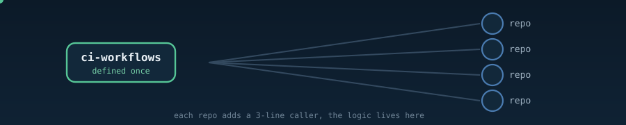

  

  
  
  
  

# ci-workflows — global CI for all my repos

Define-once CI for a **personal** GitHub account: free **Semgrep OSS** security scanning and
**ruff / eslint+tsc** linting (reusable workflows) + free **CodeRabbit** AI PR review
(account-level app).

> Replace `fredman08` with your GitHub username anywhere it appears if different.

## What's here

| File | Role |
|------|------|
| `.github/workflows/semgrep.yml` | The **reusable** Semgrep workflow (`on: workflow_call`). Lives once, in this repo. |
| `.github/workflows/lint.yml` | The **reusable** Lint workflow — auto-detects Python (ruff) and/or Node (eslint via your `lint` script, plus tsc). |
| `.github/workflows/verify.yml` | Server-side blocked-word scan for this repo; needs the `BLOCKED_PATTERNS` repo secret or it fails. |
| `.github/dependabot.yml` | Weekly Dependabot updates for the Actions used here. |
| `templates/security.yml` | The **small caller** you drop into each repo at `.github/workflows/security.yml`. |
| `templates/lint.yml` | The **small caller** for the Lint gate at `.github/workflows/lint.yml`. |
| `templates/.coderabbit.yaml` | Optional CodeRabbit config (works with zero config too). |

## Define once, call everywhere

  

The scanning/linting logic lives **once** in this repo's reusable workflows. Each repo adds a tiny
caller that says "run that workflow" — so fixing or upgrading a check is a single edit here, not a
change in every repo.

### Reality check on "global" for a personal account

- **CodeRabbit is truly global** — one account-level app install covers all repos (incl. future ones). No files needed.
- **Semgrep + Lint are "define once, add a small caller per repo"** — GitHub's auto-apply workflow features (required / default / starter workflows) are **org-only**; a personal account can't auto-inject a workflow into every repo. The reusable-workflow + per-repo caller pattern above is the closest equivalent. Keep a **template repo** so new repos are born with the callers.

## One-time setup

1. **Create this repo**: push this folder to `fredman08/ci-workflows` and keep it **public**, then create the tag the callers pin to: `git tag v1 && git push origin v1` (callers fail without it). Repos owned by any other account, including your orgs, can only call a reusable workflow if its repo is public; a private one is callable only by your personal repos.
2. **If you make it private** (personal repos only): repo **Settings → Actions → General → Access → "Accessible from repositories owned by 'fredman08' user" → Save**. Without this, a private reusable workflow is callable only from itself.
3. **Install CodeRabbit** once: go to https://coderabbit.ai → "Login with GitHub" → install the **CodeRabbit GitHub App** → select **"All repositories"**. Done — every PR is reviewed automatically, no file required. Free tier covers private repos (rate limit ~4 reviews/hr — a non-issue solo).

## Just want the gates? (no clone needed)

Copy the callers from `templates/` into your repo as described in [Per repo that needs the gates](#per-repo-that-needs-the-gates). They call `fredman08/ci-workflows@v1` on GitHub and run on GitHub's runners, so nothing needs installing locally.

## Running your own copy (fork or clone)

Cloning alone does nothing — the callers point at GitHub, not your disk. To run your own copy:

1. Replace `fredman08` with your GitHub username in `templates/`, `README.md` and `SECURITY.md` (and `LICENSE` if you want your name there).
2. Follow One-time setup steps 1 and 3 above: public repo, then the `v1` tag (`git tag v1 && git push origin v1`), plus CodeRabbit if you want it.
3. If you forked, enable workflows in the fork's **Actions** tab (forks run none by default).
4. Add a `BLOCKED_PATTERNS` repo secret (an ERE alternation of words that must never be committed), or `verify.yml` fails. Never commit its value.

## Optional: local commit-guard hooks

`.githooks/` (pre-commit, pre-push, commit-msg, tag) blocks restricted identifiers and secrets. A fresh clone has them **off** until you opt in:

- **Needs** git and `sh`/bash (on Windows, Git for Windows — even if you use the `.ps1` script) and **gitleaks** (`winget install Gitleaks.Gitleaks`). Pre-commit refuses every commit without gitleaks; the override is `CCMEM_ALLOW_NO_SCANNER=1 git commit ...`.
- **Activate once per clone:** `bash .githooks/setup-hooks.sh` (Windows: `pwsh -File .githooks/setup-hooks.ps1`). It sets `core.hooksPath`, seeds a gitignored `.githooks/.blocked` from `.blocked.example`, and adds `git safetag`.
- **Then edit `.githooks/.blocked`:** replace the placeholder lines with your own patterns (grep ERE). Check everything with `bash .githooks/test-hooks.sh`.

## Per repo that needs the gates

> **Automated (author's local tooling, not included here):** `/new-project` and `setup-commit-guard.ps1` already deploy these callers (plus hooks, `verify.yml`, secret and branch protection) into every repo they harden. Copy by hand only for a repo outside that flow.

Copy the caller(s) you want into that repo's `.github/workflows/`, commit, open a PR:

| Gate | Copy this | Runs |
|------|-----------|------|
| Security | `templates/security.yml` → `.github/workflows/security.yml` | Semgrep on every PR + push to `main` |
| Lint | `templates/lint.yml` → `.github/workflows/lint.yml` | ruff and/or eslint+tsc on every PR + push to `main` |

**Semgrep options** (in the caller's `with:`):
- **Report-only vs gate:** the templates ship `soft-fail: true` (report-only). Set `soft-fail: false` to fail the build on findings (`--error`, the workflow default).
- **Stricter rules:** `with: { config: "p/default p/security-audit" }`.

**Lint options:** `with: { soft-fail: true }` to report issues without failing the build (default `false`; templates set `true`). Lint scans the whole repo, not just changed files. The job auto-detects the stack — Python files → `ruff`; a `package.json` → `npm run lint` (if the script is defined) and `tsc --noEmit` when a `tsconfig.json` exists.

## Notes

- **Windows is irrelevant to CI** — Actions run on GitHub's `ubuntu-latest` runners.
- **No Semgrep account/token needed** for OSS scanning. `SEMGREP_APP_TOKEN` is only for the paid managed platform (`semgrep ci`) — add it as a repo secret later if you ever adopt it.
- **SARIF → GitHub code scanning** is free only on **public** repos (private needs paid GitHub Advanced Security), so this config gates via pass/fail + logs instead of the Security tab.
- **Pinned by tag:** the templates call `@v1`, so pushes to `main` don't reach callers. Move the `v1` tag deliberately to roll out a change.
- **Required checks:** only `verify` is required on this repo's `main`; in a caller repo, require `semgrep / scan` and `lint / lint`. A lint/security job blocks merges only if it has `soft-fail: false` **and** is a required status check in that repo's branch protection.
- **Versions:** Dependabot (7-day cooldown) keeps SHA-pinned Action versions current; the Semgrep image is pinned in `semgrep.yml` and bumped by hand.
- **License:** MIT. Security reports: see [SECURITY.md](SECURITY.md).
- `config: "auto"` is the convenient default; switch to `p/default` if you prefer a fixed ruleset with no auto-selection (registry rules still update over time).
- The banner/fan-out graphics animate on GitHub and in browsers; some non-browser markdown viewers show the first frame statically.
